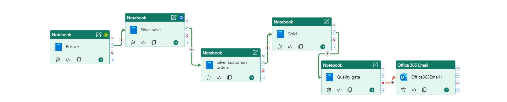
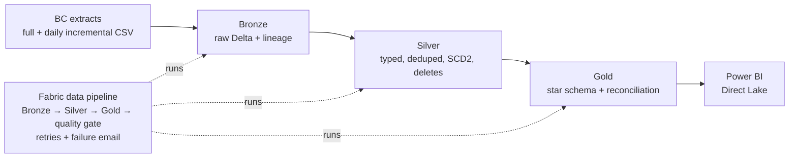

# Business Central → Microsoft Fabric Lakehouse

A practice project I built while exploring **Microsoft Fabric**: an end-to-end medallion lakehouse on **synthetic Dynamics 365 Business Central-style ERP data**, orchestrated with a Fabric data pipeline and protected by a quality gate.

> All data is synthetic, generated by [`data_generator/generate_bc_data.py`](data_generator/generate_bc_data.py). The two companies, customers, products and ABNs are fictional.

## Architecture

## The scenario

Two companies in one Business Central tenant: **CCG** (the main business) and **RIVERBEND** (an acquired business with its own customer and item numbering). Mobility and healthcare equipment sold through showrooms, with retail, NDIS, DVA, aged care, hospital and reseller customers.

The data arrives as a **full extract** (30 Sep 2026) plus **three daily incremental extracts** containing only changed records, the way an API pull lands them. Business Central's own daily totals (`data/reference/bc_control_totals.csv`) are the reconciliation target.

### Real-world problems built into the data

| Problem | How the pipeline handles it |
|---|---|
| API resend creates duplicate rows | Dedupe on the business key, latest `SystemModifiedAt` wins (`ROW_NUMBER`) |
| Cancelled orders simply disappear | Key-snapshot comparison, **two consecutive misses** before `CANCELLED`, invoice check so posted orders aren't mistaken for cancellations |
| Incomplete extract could look like mass deletes | **Snapshot guard**: stop if today's key list is < 50% of yesterday's |
| Customers move region | **SCD Type 2**, rebuilt from Bronze with a row hash, `LAG` and `LEAD`; facts use an **as-of join** |
| Item prices change | Revenue uses the invoice-line price, never the current item price |
| Late-arriving invoice (posted 30 Sep, arrives 2 Oct) | Watermark is on **arrival batch**, not business date; Gold is rebuilt, and the quality gate checks completeness |
| Invoice line for an item that no longer exists | **Unknown member** (-1), so the revenue is kept |
| Blank customer name, blank order quantity | Bad master data is **flagged**; a bad transactional update is **quarantined** and the last good version kept |
| New column appears (schema drift) | Bronze absorbs it with `mergeSchema`; Silver defaults older rows |
| Invoices vs credit memos vs payments | Single line-grain fact with credit memos negative; no mixed-grain joins |

## Notebooks

| Notebook | What it does |
|---|---|
| [`00_common`](notebooks/00_common.ipynb) | Shared loader: typing with `TRY_CAST`, quarantine with reasons, dedupe, `MERGE`, per-table watermark that only moves after success |
| [`01_bronze_ingest`](notebooks/01_bronze_ingest.ipynb) | Lands each batch as-is (all strings) with `_source_file`, `_batch_id`, `_ingested_at`; batch log for idempotent reruns |
| [`02_silver_sales`](notebooks/02_silver_sales.ipynb) | Posted invoices, credit memos, items, locations; reconciles daily net sales to Business Central |
| [`03_silver_customers_orders`](notebooks/03_silver_customers_orders.ipynb) | SCD2 customers, open orders, snapshot guard and delete detection |
| [`04_gold`](notebooks/04_gold.ipynb) | Date, customer (SCD2), product and location dimensions with hashed surrogate keys; sales fact; daily reconciliation table |
| [`05_quality_gate`](notebooks/05_quality_gate.ipynb) | Fails the run on duplicate facts, broken SCD2, reconciliation differences, Silver rows missing from Gold, or stale data |

## Results (full run)

| Check | Result |
|---|---|
| Silver vs Business Central, daily net sales | 1,010 company-days, **0 mismatches** |
| Gold fact rows | 6,645 (6,535 invoice lines + 110 credit-memo lines) |
| Duplicates removed in Silver | 3 invoice lines, 1 invoice header |
| Customer versions | 436 versions, 427 customers, 9 region changes |
| Order status | 29 open, 42 posted, 6 cancelled, 3 missing once |
| Quarantined rows | 1 (blank-quantity order update) |
| Quality gate | All checks pass |

## Run it yourself in Fabric

1. Create a workspace and a Lakehouse.
2. Upload `data/bc_extract/*` to **Files/bc_extract** and `data/reference/*` to **Files/reference**.
3. Import the notebooks from `notebooks/` (Workspace → Import → Notebook) and attach the Lakehouse to each.
4. Run `01` → `05` in order, or build the pipeline described in [`pipeline/pl_bc_daily.md`](pipeline/pl_bc_daily.md).
5. Rerun the pipeline. Bronze skips loaded batches and Silver reports "nothing new", which shows it's idempotent.

To regenerate the data: `python data_generator/generate_bc_data.py` (fixed seed, same output every time).

## Design notes and next steps

- **Deletes:** absence from a snapshot is only trustworthy when the snapshot is complete, hence the guard and the two-miss rule. Where the source supports it, CDC or a tombstone flag is the better signal.
- **Late data:** watermarking on arrival batch means late rows aren't skipped. If Gold becomes incremental, add a lookback window (re-merge the last N days) so the SCD2 as-of join re-maps late facts.
- **Next:** Power BI semantic model on Gold (Direct Lake), mapping RIVERBEND customers (ABN/email) and products (GTIN) to conformed dimensions, and Fabric Git integration with deployment pipelines.

## Tech

Microsoft Fabric (Lakehouse, Notebooks, Data pipelines), Delta Lake, Spark SQL, PySpark.
